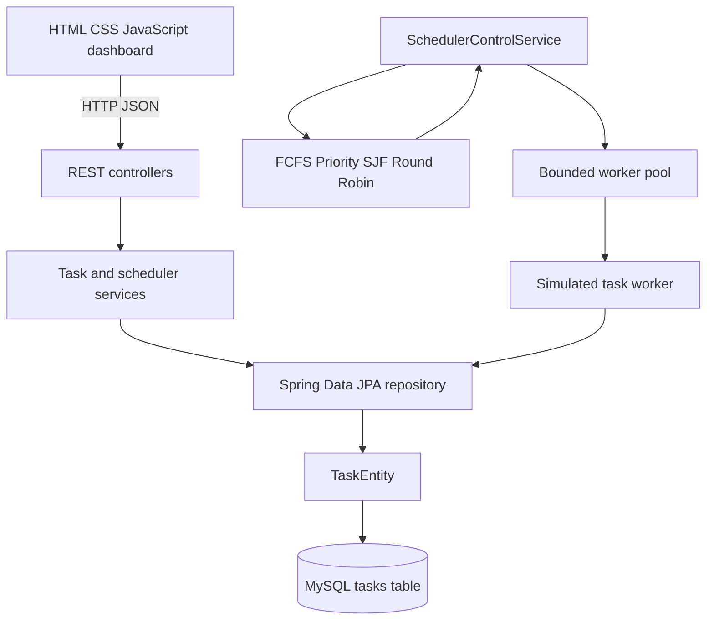
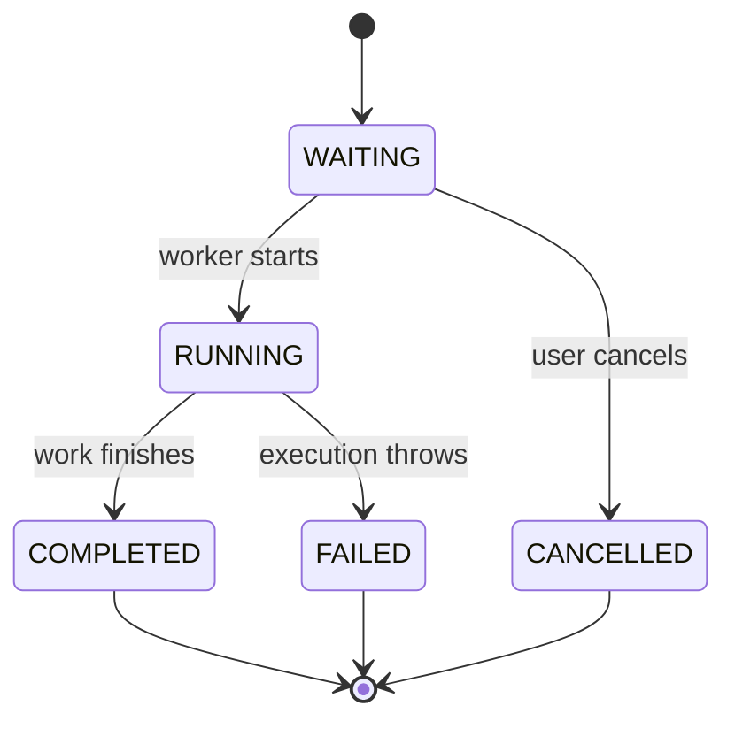

# Intelligent Task Scheduler

A Java and Spring Boot project that accepts tasks over REST, stores them in MySQL, orders waiting tasks with classic scheduling algorithms, runs them on a configurable worker pool, and displays task state and statistics in a browser dashboard.

> This is a learning and placement project. The scheduler simulates work; it does not execute arbitrary shell commands. The current runtime is designed for one application instance and local development.

## The Problem

Running every submitted job directly inside an HTTP request makes users wait for slow work and can create too many threads when requests arrive together. A scheduler separates job submission from execution, applies a configurable ordering rule, limits the number of active workers, and records job state.

## Features

- Task creation, listing, lookup, cancellation, and deletion APIs.
- Task lifecycle states: `WAITING`, `RUNNING`, `COMPLETED`, `FAILED`, and `CANCELLED`.
- FCFS, Priority, Shortest Job First, and Round Robin scheduling.
- Configurable time quantum and fixed-size, resizable worker pool.
- MySQL persistence for task inputs, status, arrival/start/completion times, and worker thread name.
- Statistics for completed/failed tasks, average waiting/turnaround/response times, and throughput.
- Responsive HTML/CSS/JavaScript dashboard served by Spring Boot.
- JUnit 5, Mockito, and Spring MVC tests.

## Architecture



### Main packages

| Package      | Responsibility                                                  |
| ------------ | --------------------------------------------------------------- |
| `controller` | HTTP routes and request/response handling                       |
| `service`    | Task operations, scheduling dispatch, and statistics            |
| `scheduler`  | Scheduling interface, algorithm implementations, metrics helper |
| `worker`     | Simulated task execution and worker-pool management             |
| `entity`     | JPA database model                                              |
| `repository` | Spring Data JPA database access                                 |
| `model`      | Task, task status, and in-memory execution metrics              |
| `dto`        | API request and response objects                                |
| `exception`  | API error mapping and task-not-found exception                  |

The browser is in `src/main/resources/static`. Spring Boot serves `index.html` at `/`.

## Scheduling Algorithms

| Algorithm   | Rule                                                                           | Data structure / complexity                   |
| ----------- | ------------------------------------------------------------------------------ | --------------------------------------------- |
| FCFS        | Preserve input order                                                           | FIFO queue; `O(n)` to return the order        |
| Priority    | Higher numeric priority first                                                  | Priority queue; `O(n log n)` to order a batch |
| SJF         | Shorter burst first                                                            | Min-heap; `O(n log n)` to order a batch       |
| Round Robin | Run each task for at most the configured quantum, then rotate unfinished tasks | Queue; `O(s)` for `s` generated slices        |

Round Robin slices preserve the original task ID and collectively cover its burst time. For example, burst `5` with quantum `2` becomes slices `2, 2, 1`.

FCFS preserves the order supplied to it. The current repository read does not explicitly sort by `arrivalTime`, so strict database-level arrival ordering is a known improvement.

## Task Lifecycle



`TaskStatus` validates transitions so terminal states cannot be restarted or cancelled. Stopping the scheduler stops future dispatch; already-started tasks are allowed to finish.

## Database

The current JPA entity maps to the `tasks` table with these main fields:

| Field                            | Purpose                                       |
| -------------------------------- | --------------------------------------------- |
| `id`                             | Database-generated task ID                    |
| `name`, `priority`, `burst_time` | Submitted task properties                     |
| `arrival_time`                   | Task arrival timestamp                        |
| `status`                         | Current lifecycle state                       |
| `started_at`, `completed_at`     | Execution timestamps                          |
| `worker_id`                      | Java worker thread name that handled the task |

Hibernate uses `spring.jpa.hibernate.ddl-auto=update` for local development. There is not yet a separate `execution_history` table; Round Robin slices are not stored as individual history records. Scheduler settings are in memory and reset when the application restarts.

## Metrics

For valid terminal task records, the statistics service calculates times in seconds:

```text
turnaround = completion time - arrival time
response   = start time - arrival time
simulated burst = burst units * 0.1 seconds
waiting    = max(0, turnaround - simulated burst)
throughput = completed tasks / observation window in seconds
```

The observation window spans the earliest arrival to the latest completion in the timed sample. Metrics return zero if there is no valid sample or the time window is zero. These are simulation metrics, not CPU utilization measurements.

## API

| Method   | Path                          | Purpose                                         |
| -------- | ----------------------------- | ----------------------------------------------- |
| `POST`   | `/api/tasks`                  | Create a task                                   |
| `GET`    | `/api/tasks`                  | List tasks                                      |
| `GET`    | `/api/tasks/{id}`             | Get a task                                      |
| `POST`   | `/api/tasks/{id}/cancel`      | Cancel a waiting task                           |
| `DELETE` | `/api/tasks/{id}`             | Delete a task                                   |
| `POST`   | `/api/scheduler/start`        | Start dispatching waiting tasks                 |
| `POST`   | `/api/scheduler/stop`         | Stop future dispatch                            |
| `GET`    | `/api/scheduler/status`       | Read status and configuration                   |
| `PUT`    | `/api/scheduler/algorithm`    | Set `FCFS`, `PRIORITY`, `SJF`, or `ROUND_ROBIN` |
| `PUT`    | `/api/scheduler/workers`      | Configure worker count                          |
| `PUT`    | `/api/scheduler/time-quantum` | Configure Round Robin quantum                   |
| `GET`    | `/api/statistics`             | Read task counts and execution metrics          |

Request examples:

```json
POST /api/tasks
{
  "name": "Generate report",
  "priority": 8,
  "burstTime": 5
}
```

```json
PUT /api/scheduler/algorithm
{
  "algorithm": "PRIORITY"
}
```

Input validation returns `400 Bad Request`, a missing task returns `404 Not Found`, and an invalid lifecycle transition returns `409 Conflict`.

## Run Locally

### Requirements

- Java 21
- Maven
- MySQL or compatible local MariaDB (XAMPP is suitable)

Start MySQL/MariaDB first. The default `src/main/resources/application.properties` targets `localhost:3306`, database `task_scheduler_db`, and local root with a blank password. Confirm these values match your local database.

Spring Boot properties can be overridden with environment variables. Example PowerShell session:

```powershell
$env:SPRING_DATASOURCE_URL = "jdbc:mysql://localhost:3306/task_scheduler_db?createDatabaseIfNotExist=true&useSSL=false&allowPublicKeyRetrieval=true&serverTimezone=UTC"
$env:SPRING_DATASOURCE_USERNAME = "root"
$env:SPRING_DATASOURCE_PASSWORD = ""
mvn spring-boot:run
```

Run tests:

```powershell
mvn test
```

Run the app:

```powershell
mvn spring-boot:run
```

Open <http://localhost:8080/> for the dashboard. Use small burst values for demos: one burst unit simulates 100 milliseconds of work.

## Testing

The current suite has passed with **47 tests, 0 failures, 0 errors**. It covers algorithms, task lifecycle, worker-pool behavior, scheduler dispatch ordering and persistence with mocked repositories, statistics, MVC endpoints, validation, and Spring application startup.

The next test milestone is broader database-backed concurrency testing, especially proving each task is executed exactly once under concurrent load.

## Known Limitations and Roadmap

- The scheduler's in-flight guard is local to one Java process. Multiple application instances need database-level atomic task claiming or locking.
- The worker pool uses an unbounded executor queue; production use should add backpressure.
- The scheduler polls `findAll()` every 100 ms rather than querying an indexed waiting-task queue.
- FCFS needs an explicit repository sort by arrival time for guaranteed arrival ordering.
- The scheduler state and algorithm/worker/quantum settings are not persisted across restarts.
- Worker ID is a thread name, not a durable worker entity.
- No per-slice `execution_history` table exists yet.
- Statistics API exists; algorithm-comparison endpoint is not implemented.
- Gantt chart, algorithm-comparison page, Priority Aging, performance measurements, Docker setup, and full project README assets are still planned.

The recommended next feature after the dashboard is execution history, which enables a faithful Gantt chart and gives Round Robin slices durable records.

## Learning Guide

See [the placement interview guide](docs/placement-interview-guide.md) for a beginner-to-advanced explanation, diagrams, formulas, source-code reading order, interview pitches, questions, and system-design follow-ups. A PDF version is available at [docs/placement-interview-guide.pdf](docs/placement-interview-guide.pdf). To regenerate it, install the optional dependency with `python -m pip install -r docs/requirements-pdf.txt` and run `python docs/generate_pdf.py`.

## Safety

Tasks are simulated with Java sleep. The application does not execute arbitrary shell commands from task submissions. Do not commit real database passwords or `.env` files; `.gitignore` excludes these local environment files.
