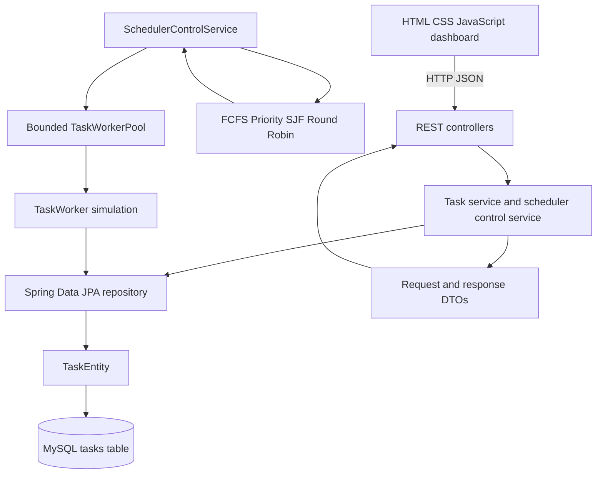
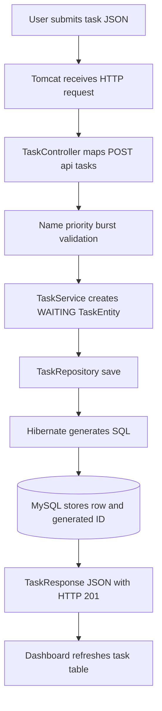
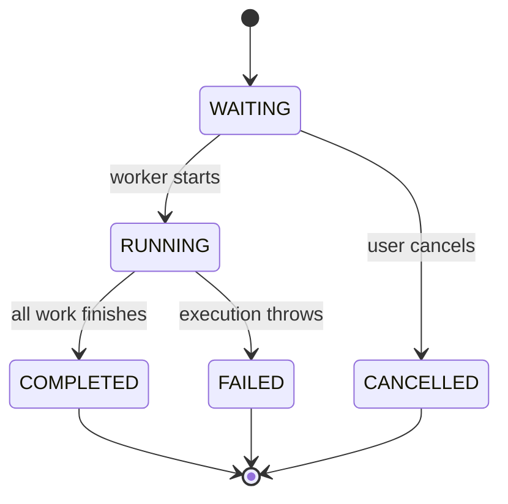

# Intelligent Task Scheduler

## Beginner-to-Advanced Placement Interview Guide

**Audience:** A Java learner who knows classes, objects, collections, and basic threads, but is new to Spring Boot and wants to explain this project confidently in interviews.

**Project state covered:** Implementation through the dashboard phase. This guide describes the current code, including limitations; it does not pretend unfinished roadmap items already exist.

---

## 1. The Project in One Minute

The Intelligent Task Scheduler is a small job-execution platform. A client submits jobs such as “Generate report” with a priority and an estimated amount of work. The application stores them in MySQL, chooses which waiting job should go next, gives work to a limited number of worker threads, updates each job's status, and reports execution statistics in a browser dashboard.

The core path is:

```text
Browser -> HTTP API -> Spring service -> MySQL task row
                                      -> scheduling algorithm
                                      -> bounded worker pool
                                      -> persisted result and statistics
```

The key learning value is not that this is a massive distributed system. It is that one understandable application combines Java collections and algorithms, REST, validation, persistence, state transitions, multithreading, and measurement.

### How to use this guide

Read Sections 1–8 first to understand the story and Spring vocabulary. Read Sections 9–12 alongside the algorithms, worker, and dashboard code. Use Sections 14–15 to run and test the project. Finish with Sections 16–20 for honest scope, a personal project pitch, interview questions, and advanced design follow-ups.

### A child-friendly analogy

Imagine a library with a basket of repair requests. Each request says what is broken, how urgent it is, and how long it may take. A librarian records requests in a notebook, a rule chooses the next request, and a fixed team of repairers works on them. The notebook is the database, the librarian's rules are scheduling algorithms, repairers are worker threads, and the dashboard is the noticeboard.

This analogy also reveals the hard parts: do not give the same request to two repairers, do not mark a request finished too early, and do not claim that a repair took 2 seconds if no clock was measured.

## 2. What Problem Does It Solve?

If many jobs arrive together, executing them directly inside an HTTP request is a poor design:

- A slow job keeps the user's request waiting.
- Too many simultaneous jobs can create too many threads and exhaust memory or CPU.
- There is no clear policy for deciding which job runs first.
- A process restart can lose jobs if they exist only in memory.
- Without status and timing data, operators cannot see whether work is waiting, running, completed, or failing.

This project separates **accepting work**, **ordering work**, **executing work**, and **reporting results**. Its current executor simulates safe work with `Thread.sleep`; it does not run arbitrary commands submitted by users.

## 3. Technology Stack, Starting From Java

| Technology                    | What it means here                                       | Why it is useful                                                         |
| ----------------------------- | -------------------------------------------------------- | ------------------------------------------------------------------------ |
| Java 21                       | The language and runtime for the backend                 | Types, classes, collections, exceptions, concurrency APIs                |
| Spring Boot 3.3.3             | A framework that starts and wires the backend            | Creates the web server, discovers components, configures common services |
| Spring Web / MVC              | Maps HTTP requests to Java methods                       | `@RestController`, `@GetMapping`, request and response JSON              |
| Jakarta Validation            | Checks request data                                      | Rejects blank names and non-positive values before business logic        |
| Spring Data JPA               | Repository abstraction for database access               | Methods such as `save`, `findAll`, and `findById`                        |
| Hibernate                     | JPA implementation that maps Java entities to SQL tables | Converts entity reads/writes to SQL and can update the schema            |
| MySQL / XAMPP MariaDB         | Persistent task storage                                  | Keeps task records after the Java process exits                          |
| Maven                         | Build and dependency tool                                | Downloads libraries, compiles code, runs tests and the app               |
| HTML, CSS, JavaScript         | Browser dashboard                                        | No React or separate frontend server is required                         |
| JUnit 5, Mockito, Spring Test | Test tools                                               | Test algorithms, services, persistence integration, and HTTP controllers |

### What is Spring Boot?

In plain Java, we might manually create every object and connect it to every dependency. Spring Boot starts an application context, discovers classes marked with annotations such as `@Service` and `@RestController`, creates their objects, and supplies required dependencies through constructors. This is called **dependency injection**.

For example, `TaskController` asks for a `TaskService` in its constructor. Spring finds the service object and provides it. The controller does not construct a database connection or a service itself.

`@SpringBootApplication` on `TaskSchedulerApplication` combines configuration, auto-configuration, and component scanning. Since the other packages are beneath `com.task.scheduler`, Spring can discover them automatically.

### What does Maven do?

`pom.xml` is the build recipe. It declares Java 21, the Spring Boot parent, dependencies, and the Spring Boot Maven plugin. `mvn test` compiles production and test code and executes tests. `mvn spring-boot:run` launches the web application. Dependencies are libraries; their presence does not mean the important scheduling logic is hidden in them. The project implements the scheduling policies itself.

## 4. Architecture: Who Is Responsible for What?



### Layer responsibilities

1. **Controller:** speaks HTTP. It receives JSON, calls a service, and chooses a response. It should not contain SQL or scheduling logic.
2. **DTO:** the API's input/output shape. It protects the public API from exposing database entities directly.
3. **Service:** business operations. `TaskService` creates, reads, cancels, and deletes tasks. `SchedulerControlService` manages configuration and dispatch.
4. **Scheduler:** decides order. Each algorithm implements the shared `SchedulingAlgorithm` contract.
5. **Worker:** performs simulated execution. A worker receives a slice of work and sleeps for the corresponding duration.
6. **Entity:** a Java object mapped to a database row. `TaskEntity` has JPA annotations.
7. **Repository:** database access interface. `TaskRepository` extends `JpaRepository<TaskEntity, Long>`.
8. **Exception handler:** turns expected Java exceptions into consistent HTTP error responses.

The layers are useful because changing one responsibility should not require rewriting all the others. For example, the dashboard can change its layout without changing task ordering.

## 5. Main Objects and the Database

### Three different representations of “a task”

- `Task` is a scheduling/execution model. It is lightweight and is used by algorithms and workers.
- `TaskEntity` is the persisted JPA object. It represents the `tasks` table and contains the database ID and persisted status/timestamps.
- `TaskResponse` is an API response DTO. It contains fields the browser needs without returning a JPA entity.

`CreateTaskRequest` is a separate input DTO. It has validation rules: name must not be blank, and priority and burst time must be at least 1.

### Current persisted task fields

| Java field    | Meaning                                                            |
| ------------- | ------------------------------------------------------------------ |
| `id`          | Database-generated task identity                                   |
| `name`        | Human-readable task name                                           |
| `priority`    | Larger number is scheduled earlier by Priority Scheduling          |
| `burstTime`   | Simulated work units; each unit sleeps for 100 ms                  |
| `arrivalTime` | When the task was accepted                                         |
| `status`      | `WAITING`, `RUNNING`, `COMPLETED`, `FAILED`, or `CANCELLED`        |
| `startedAt`   | When a worker first began the task                                 |
| `completedAt` | When a task completed or failed                                    |
| `workerId`    | Current/last Java worker thread name, such as `scheduler-worker-1` |

The database schema is managed from `TaskEntity`. `@Entity` says it is persistent; `@Table(name = "tasks")` chooses the table; `@Id` marks its identity; `@GeneratedValue` lets the database generate it; `@Column(nullable = false)` declares required fields; and `@Enumerated(EnumType.STRING)` stores readable status names instead of ordinal numbers.

There is currently one main table, `tasks`. There is **not yet** a separate `execution_history` table, so individual Round Robin slices are not saved as separate history records. Worker ID on the task row stores one thread name, not a full worker registry.

### How does the database connection work?

`application.properties` defines the JDBC URL, username, password, and driver. The current local setup uses `localhost:3306`, database `task_scheduler_db`, user `root`, and a blank password. This is a local-development setting, not a production secret-management pattern.

Spring Boot configures a connection pool and Hibernate/JPA. `TaskRepository` calls operations such as `save` and `findAll`; Hibernate turns them into SQL. `spring.jpa.hibernate.ddl-auto=update` asks Hibernate to adjust tables to match entity fields at startup. It is convenient while learning, but production systems normally use explicit migration tools so schema changes are reviewed and repeatable.

“Sync” does not mean the Java object and table are continuously mirrored in both directions. A repository call loads or writes data within database transactions. When a worker changes an entity and calls `save`, that change is persisted. The database is the durable source of task records; scheduler configuration is currently only in application memory.

## 6. One Request, Step by Step



Example request:

```http
POST /api/tasks
Content-Type: application/json

{
  "name": "Generate report",
  "priority": 8,
  "burstTime": 5
}
```

What happens:

1. The browser sends JSON, not a Java object.
2. Spring MVC reads the request body and creates a `CreateTaskRequest`.
3. Jakarta Validation rejects a blank name, priority below 1, or burst below 1.
4. `TaskController` delegates to `TaskService`.
5. The service creates a `TaskEntity` with current arrival time and `WAITING` status.
6. `TaskRepository.save` delegates persistence to JPA/Hibernate.
7. The database generates an ID; the service maps the saved entity into `TaskResponse`.
8. The controller returns HTTP `201 Created` and JSON.

The DTO boundary matters: a future internal field can be added to the entity without automatically becoming public API data.

## 7. APIs You Can Explain in an Interview

| Method and path                   | Purpose                                            | Typical response                             |
| --------------------------------- | -------------------------------------------------- | -------------------------------------------- |
| `POST /api/tasks`                 | Create a task                                      | `201 Created`, `TaskResponse`                |
| `GET /api/tasks`                  | List tasks                                         | `200 OK`, array of responses                 |
| `GET /api/tasks/{id}`             | Get one task                                       | `200 OK`; `404` if missing                   |
| `POST /api/tasks/{id}/cancel`     | Cancel a waiting task                              | `200 OK`; `409` if the transition is invalid |
| `DELETE /api/tasks/{id}`          | Delete a task                                      | `204 No Content`                             |
| `POST /api/scheduler/start`       | Start polling/dispatch                             | `200 OK`, scheduler state                    |
| `POST /api/scheduler/stop`        | Stop future dispatch                               | `200 OK`, scheduler state                    |
| `GET /api/scheduler/status`       | Read runtime settings                              | `200 OK`, status/configuration               |
| `PUT /api/scheduler/algorithm`    | Choose `FCFS`, `PRIORITY`, `SJF`, or `ROUND_ROBIN` | `200 OK`                                     |
| `PUT /api/scheduler/workers`      | Change worker count                                | `200 OK`; positive integer required          |
| `PUT /api/scheduler/time-quantum` | Set Round Robin quantum                            | `200 OK`; positive integer required          |
| `GET /api/statistics`             | Read execution counts and metrics                  | `200 OK`, statistics JSON                    |

Error mapping is centralized in `ApiExceptionHandler`: missing task is `404`, invalid input is `400`, and illegal state transitions are `409`.

PowerShell example:

```powershell
Invoke-RestMethod -Method Post `
  -Uri http://localhost:8080/api/tasks `
  -ContentType 'application/json' `
  -Body '{"name":"Generate report","priority":8,"burstTime":5}'
```

## 8. Task Status Is a State Machine



`TaskStatus.transitionTo` is the rulebook. It allows `WAITING -> RUNNING`, `WAITING -> CANCELLED`, `RUNNING -> COMPLETED`, and `RUNNING -> FAILED`. It rejects other transitions by throwing `IllegalStateException`. The same policy is used by the in-memory `Task` model and the persisted `TaskEntity`.

Why not simply make `status` public? Because any caller could then jump from `WAITING` directly to `COMPLETED`. Encapsulating state changes protects an invariant: every task follows a legal lifecycle.

Cancellation is only valid while waiting. Once work is running, the current API does not interrupt the worker; it rejects cancellation with a conflict response. Scheduler Stop is a different concept: it stops dispatching new work but allows already-accepted worker tasks to finish.

## 9. The Scheduling Algorithms and Their Data Structures

The common interface is `SchedulingAlgorithm`, which asks each policy to return tasks in scheduling order. This is polymorphism: the dispatcher can hold a `SchedulingAlgorithm` reference while the actual object is FCFS, Priority, SJF, or Round Robin.

| Algorithm   | Data structure / idea                  | What this project does                                        | Typical ordering complexity    |
| ----------- | -------------------------------------- | ------------------------------------------------------------- | ------------------------------ |
| FCFS        | FIFO queue                             | Preserves the supplied list's order                           | `O(n)` to materialize order    |
| Priority    | Max-priority queue behavior            | Higher numeric priority first                                 | `O(n log n)` to build/poll all |
| SJF         | Min-heap behavior                      | Smaller burst time first                                      | `O(n log n)` to build/poll all |
| Round Robin | FIFO queue plus remaining-work counter | Emits slices of at most the quantum, rotates unfinished tasks | `O(s)` for `s` emitted slices  |

For Round Robin, if task `i` has burst `B_i` and quantum `Q`, the number of slices is approximately `ceil(B_i / Q)`. Across all tasks, `s = sum(ceil(B_i / Q))`. If a task has burst 5 and quantum 2, its slices are 2, 2, and 1. No slice exceeds the quantum; all slices sum to the original burst.

SJF here orders a batch of tasks before dispatch. It is **not preemptive SRTF**: an already-running task is not interrupted when another shorter task arrives. Priority has the same non-preemptive batch character once a task is running.

One detail to discuss honestly: FCFS preserves the list order supplied to it. A database query without an explicit `ORDER BY arrival_time` does not guarantee arrival ordering. A production-strength FCFS query should request a stable arrival-time order from the repository.

## 10. Threads, Pools, and Safety

Creating one thread for every task can overwhelm a machine. `TaskWorkerPool` instead wraps a `ThreadPoolExecutor` with a fixed number of active worker threads and a queue. The pool can be resized. Worker names use a counter, so the dashboard can show a thread name as worker ID.

The dispatcher runs periodically on a separate single-thread scheduled executor. It:

1. Reads persisted tasks and filters for `WAITING`.
2. Skips IDs already in the local `inFlightTaskIds` concurrent set.
3. Converts entities to lightweight `Task` objects.
4. Chooses the configured algorithm and builds the execution order.
5. Submits work to the worker pool.
6. A worker reloads the entity, marks it `RUNNING`, saves worker/timing data, performs simulated work, and saves `COMPLETED`; exceptions lead to `FAILED`.
7. Removes the task ID from the local in-flight set when the execution chain completes.

`ConcurrentHashMap.newKeySet()` is used for thread-safe ID membership. `volatile` fields let the dispatcher observe updates to runtime settings. Synchronized control methods protect start/stop/configuration changes from concurrent API calls. `@PreDestroy` cancels polling and shuts down executors when Spring closes.

### Important safety boundary

The in-flight set protects one running Java process. It is not a distributed lock. If two application instances point at the same database, both could read the same `WAITING` row before either saves it as `RUNNING`. A scaled-out design needs an atomic claim, for example a transaction with row locking or a conditional update such as “change WAITING to RUNNING only if it is still WAITING,” then verify the update count.

Also, the thread pool uses an unbounded `LinkedBlockingQueue`. The number of simultaneously executing tasks is limited, but a very large backlog can still consume memory. A production design would use a bounded queue and explicit backpressure/rejection behavior.

## 11. How Metrics Are Calculated

The statistics service only uses terminal tasks with valid arrival/start/completion timestamps for timing averages. Counts are status counts from stored task rows.

Let `A` be arrival time, `S` start time, `C` completion time, and `B` burst units.

```text
Turnaround time = C - A
Response time   = S - A
Simulated burst = B * 0.1 seconds
Waiting time    = max(0, turnaround time - simulated burst)
Throughput      = completed task count / elapsed observation window
```

Times are converted to seconds. Throughput's window starts at the earliest arrival in the timed sample and ends at its latest completion. If there is no valid sample or the elapsed window is zero, the API returns `0.0` rather than dividing by zero.

Do not say that waiting time is measured by watching the process wait in a queue; the code derives it using turnaround minus simulated burst. Do not claim CPU utilization: the current API does not calculate it. For Round Robin, actual wall-clock scheduling/queue overhead means this simplified formula is a useful learning estimate, not a high-precision operating-systems benchmark.

## 12. The Browser Dashboard

The browser is plain HTML, CSS, and JavaScript under `src/main/resources/static`. Spring Boot serves `index.html` at `/`; no Node build or React app is required.

- The page periodically requests `/api/tasks`, `/api/scheduler/status`, and `/api/statistics`.
- The task form posts JSON to `/api/tasks`.
- Cancel buttons post to `/api/tasks/{id}/cancel`.
- Start/Stop call scheduler endpoints.
- Configuration changes send PUT requests.
- A dirty-form flag prevents background refresh from overwriting values the user is editing.
- User-provided text is inserted with `textContent`, not interpreted as HTML.
- At narrow widths, the task table scrolls inside its own container instead of expanding the whole page.

The Worker column now comes from the persisted thread name. A thread name is useful for a learning dashboard, but a more complete worker model would have stable worker records, capacity, health, and heartbeat data.

## 13. Folder Map: Where to Read First

| Path                                                                                                                                       | Purpose                                                                             |
| ------------------------------------------------------------------------------------------------------------------------------------------ | ----------------------------------------------------------------------------------- |
| `src/main/java/com/task/scheduler/TaskSchedulerApplication.java`                                                                           | Application entry point and Spring component scan                                   |
| `src/main/java/com/task/scheduler/controller/TaskController.java`                                                                          | Task HTTP routes                                                                    |
| `src/main/java/com/task/scheduler/controller/SchedulerController.java`                                                                     | Scheduler control routes                                                            |
| `src/main/java/com/task/scheduler/controller/StatisticsController.java`                                                                    | Statistics route                                                                    |
| `src/main/java/com/task/scheduler/service/TaskService.java`                                                                                | Task create/read/cancel/delete logic and entity-to-DTO mapping                      |
| `src/main/java/com/task/scheduler/service/SchedulerControlService.java`                                                                    | Dispatcher lifecycle, algorithm selection, in-flight tracking, worker submission    |
| `src/main/java/com/task/scheduler/service/StatisticsService.java`                                                                          | Metrics calculated from persisted task records                                      |
| `src/main/java/com/task/scheduler/model/Task.java`                                                                                         | Lightweight algorithm/worker model                                                  |
| `src/main/java/com/task/scheduler/model/TaskStatus.java`                                                                                   | Allowed lifecycle transition rules                                                  |
| `src/main/java/com/task/scheduler/entity/TaskEntity.java`                                                                                  | JPA mapping for `tasks`                                                             |
| `src/main/java/com/task/scheduler/repository/TaskRepository.java`                                                                          | Spring Data JPA interface                                                           |
| `src/main/java/com/task/scheduler/scheduler/SchedulingAlgorithm.java` and algorithm classes                                                | Scheduling contract and FCFS/Priority/SJF/Round Robin implementations               |
| `src/main/java/com/task/scheduler/scheduler/SchedulingMetrics.java` and `src/main/java/com/task/scheduler/model/TaskExecutionMetrics.java` | In-memory metric helpers; persisted statistics use `StatisticsService`              |
| `src/main/java/com/task/scheduler/worker/TaskWorker.java` and `src/main/java/com/task/scheduler/worker/TaskWorkerPool.java`                | Simulated task execution and fixed worker pool                                      |
| `src/main/java/com/task/scheduler/worker/TaskExecutionTracker.java`                                                                        | Standalone thread-safe helper; active dispatch tracks IDs in its own concurrent set |
| `src/main/java/com/task/scheduler/dto/`                                                                                                    | API request and response types                                                      |
| `src/main/java/com/task/scheduler/exception/ApiExceptionHandler.java`                                                                      | Converts expected errors into HTTP responses                                        |
| `src/main/resources/application.properties`                                                                                                | Port, database URL/credentials, Hibernate settings                                  |
| `src/main/resources/static/`                                                                                                               | Dashboard HTML, CSS, JavaScript                                                     |
| `src/test/java/`                                                                                                                           | JUnit, Mockito, algorithm, service, controller, and worker tests                    |

## 14. Run and Demonstrate It

Prerequisites: Java 21, Maven, and local MySQL/MariaDB. The configured local root password is blank; change configuration safely for any environment where that is not true. Start the database before starting the Spring application.

```powershell
mvn test
mvn spring-boot:run
```

Open `http://localhost:8080/`. Create two small jobs with different priorities, configure the Priority algorithm and one worker, start the scheduler, and watch status, worker, start time, completion time, and metrics update. Stop the scheduler afterward. For Round Robin, choose a quantum such as 1 or 2 and compare the order in service tests or future execution-history UI.

The project currently uses `burstTime * 100 ms` for simulated execution. Keep demo bursts small because the workers really sleep for that duration.

## 15. Testing: What the Green Build Means

The current full run reported **47 tests, 0 failures, 0 errors**. Coverage includes:

- FCFS, Priority, SJF, and Round Robin ordering.
- Round Robin slice sizes and rotation.
- Task lifecycle transitions.
- Worker execution and pool resizing.
- Scheduler persistence, worker assignment, priority ordering, and Round Robin dispatch order with a mocked repository.
- Statistics formulas and empty-data behavior.
- MVC routes and request validation.
- Spring application context and live datasource startup.

The scheduler integration tests do not execute existing rows in the live local database; they use a mocked repository. The browser smoke check used and deleted one temporary row and left unrelated waiting rows untouched. The next testing step is a controlled dedicated database test for end-to-end persistence, failure handling, and concurrency, followed by a stress/performance phase.

## 16. What Is Done and What Is Left?

The requested roadmap has 26 phases. The current implementation reaches the Dashboard phase, but a few named subfeatures remain:

| Phase | Status                                                                                                                                |
| ----- | ------------------------------------------------------------------------------------------------------------------------------------- |
| 1–13  | Foundation is present: project, model, algorithms, metrics, workers, REST, and JPA; see limitations below for missing planned details |
| 14–16 | Implemented: database-backed execution and scheduler controls                                                                         |
| 17    | Statistics endpoint implemented; algorithm-comparison endpoint still missing                                                          |
| 18    | Dashboard implemented and checked at desktop/mobile widths                                                                            |
| 19    | Gantt chart not implemented; needs per-slice execution history                                                                        |
| 20    | Algorithm comparison page/API not implemented                                                                                         |
| 21    | Priority Aging not implemented                                                                                                        |
| 22    | Dedicated comprehensive test phase remains; tests exist but more edge/concurrency coverage is needed                                  |
| 23    | Performance measurements not done                                                                                                     |
| 24    | Docker not done                                                                                                                       |
| 25    | Full README/documentation pack not done; this guide is a placement-learning guide, not the final project README                       |
| 26    | Resume bullet and interview practice are not yet tailored to measured outcomes                                                        |

Other current limitations to disclose in an interview: no `execution_history` table; task rows store only an overall start/completion and a worker thread name. Scheduler settings reset when the application restarts. Polling currently reads all task rows every 100 ms. The in-flight guard is process-local and does not provide multi-instance locking. FCFS needs an explicit database ordering to guarantee arrival order. The statistics comparison endpoint, CPU utilization, aging, chart, Docker setup, and measured performance report are not present.

## 17. Interview Introduction You Can Make Your Own

### 30-second version

“I built an Intelligent Task Scheduler in Java and Spring Boot. Users submit tasks through REST APIs; tasks are stored in MySQL with lifecycle state. A scheduler orders waiting tasks using FCFS, Priority, SJF, or Round Robin and executes them on a configurable bounded worker pool. I added state-transition validation, persistence of start/completion times and worker IDs, statistics, a plain JavaScript dashboard, and JUnit/Mockito tests. I focused on keeping API, business logic, persistence, scheduling, and execution responsibilities separate.”

### Two-minute version

“The project addresses what happens when several jobs arrive together: how to store them, choose a fair or efficient order, run a controlled number concurrently, and show results. Spring MVC maps JSON routes to controllers, request DTOs validate input, and services contain task and scheduler behavior. JPA maps `TaskEntity` to MySQL. The scheduler polls waiting rows, uses a shared scheduling interface to choose FCFS, Priority, SJF, or Round Robin, and submits work through a fixed-size `ThreadPoolExecutor`. Worker status and timing are saved back to the row; the statistics service derives averages and throughput, and the static dashboard consumes the APIs. I tested algorithm behavior, lifecycle rules, dispatch ordering, controller validation, and the application context. The current design is intentionally single-process and learning-scale: distributed atomic claiming, detailed execution history, algorithm comparison, aging, performance benchmarking, and Docker remain future work.”

Do not memorize these paragraphs word for word. Run the project and replace every generic sentence with a concrete example you have observed yourself.

## 18. Interview Questions and Strong Answers

### Java and design

**Why use an interface for scheduling algorithms?**  
The dispatcher depends on the behavior “schedule these tasks,” not on one concrete policy. Each implementation can change independently, and adding a policy does not require embedding another sorting branch in every caller.

**Why have `Task`, `TaskEntity`, and `TaskResponse`?**  
They have different jobs: scheduling/execution state, database mapping, and public JSON. Separating them avoids coupling algorithms to JPA and avoids accidentally exposing persistence details.

**Why use an enum for status?**  
It limits values to a known set and makes transition rules explicit. Methods enforce valid transitions instead of allowing arbitrary string updates.

### Spring and APIs

**What does `@RestController` do?**  
It tells Spring that the class handles web requests and that returned objects should be serialized into response bodies, normally JSON.

**What is dependency injection?**  
Spring constructs collaborating objects and supplies dependencies, such as a service to a controller or a repository to a service. Constructor injection makes required dependencies visible and testable.

**Why use DTOs and validation?**  
The API should accept and expose deliberate fields, not the persistence model. Validation rejects malformed requests at the boundary before they can create invalid data.

**What does HTTP 409 mean here?**  
The request conflicts with the task’s current state, such as trying to cancel something no longer waiting.

### Algorithms and operating systems

**What is the difference between FCFS and SJF?**  
FCFS preserves arrival order; SJF chooses the smallest burst first. SJF can reduce average waiting under assumptions but may starve long jobs if short jobs keep arriving.

**Is this SJF preemptive?**  
No. It orders a batch before dispatch. A running task is not interrupted when another shorter task arrives.

**What does the Round Robin quantum control?**  
It is the maximum simulated burst units a task receives in one slice before moving behind the other waiting tasks. Small quantum improves rotation but creates more scheduling overhead; very large quantum behaves more like FCFS.

**Can we guarantee FCFS from `findAll()`?**  
No. The algorithm preserves input order, but SQL row order is undefined without `ORDER BY`. A repository query ordered by arrival time is needed for a true guarantee.

### Threads and persistence

**Why a thread pool instead of `new Thread` per task?**  
A fixed pool reuses a bounded number of worker threads and avoids unbounded thread creation. The current queue itself is unbounded, so a production version should also add backpressure.

**What prevents a task running twice?**  
The process-local concurrent in-flight ID set prevents duplicate submission by this scheduler instance. It does not prevent two application instances from claiming the same row; database-level atomic claiming is a future improvement.

**What happens when Stop is clicked?**  
Periodic dispatch stops. Already-submitted work is allowed to finish; Stop does not forcibly interrupt workers.

**What happens on application restart?**  
Task rows remain in MySQL. Scheduler status/configuration reset to defaults because those settings are currently in memory. A row that was persisted as RUNNING during a crash needs a recovery policy; one is not yet implemented.

**Is `workerId` a durable machine identity?**  
No. It is a Java thread name useful for this demo. A production system would model workers explicitly and track health/heartbeats.

### Metrics and correctness

**How is waiting time calculated?**  
Turnaround is completion minus arrival. This implementation estimates burst duration as `burstTime * 0.1` seconds and subtracts it from turnaround, clamped at zero. It is a simulation convention, not a CPU profiler measurement.

**How would you test “exactly once”?**  
Run many persisted test tasks with multiple workers, count executions per task ID, and assert every count is exactly one. For multiple application instances, test atomic DB claiming too; the current local in-flight set alone is insufficient.

**How would you improve throughput under a growing queue?**  
Use indexed status/arrival queries rather than scanning the whole table every 100 ms, claim rows atomically, bound the worker queue, add backpressure, and measure before changing pool size.

## 19. Advanced Follow-Ups: How You Would Evolve It

1. **Exactly-once vs. at-least-once:** In distributed systems, “exactly once” is difficult across database and worker side effects. Use atomic claiming, idempotency keys, and idempotent task handlers; record attempt numbers.
2. **Queue claim:** Add a transaction that atomically moves a row from WAITING to RUNNING only if still WAITING. Consider database row locks/`SKIP LOCKED` where supported.
3. **Execution history:** Add an `execution_history` table with task ID, worker ID, slice start/end, status, and attempt. This enables a real Gantt chart and preserves Round Robin slices.
4. **Crash recovery:** Record leases/heartbeats or a started timestamp and reclaim stale RUNNING tasks according to an explicit policy.
5. **Backpressure:** Bound the executor queue. Decide whether the API rejects, delays, or persists backlog when capacity is exceeded.
6. **Aging:** Increase effective priority based on waiting duration, e.g. `effectivePriority = basePriority + floor(waitSeconds / agingInterval)`. Define tie-breakers and test starvation behavior.
7. **Observability:** Add structured logs, counters, latency histograms, queue-depth gauges, and traces. Keep high-cardinality task IDs out of metric labels.
8. **Configuration durability:** Persist configuration or load it from validated environment properties; do not store secrets in source control.
9. **Migrations:** Replace `ddl-auto=update` for production with versioned migrations, backups, and rollback plans.
10. **Performance:** Benchmark 10, 100, 1,000, and 10,000 tasks. Record machine/JDK/database details and actual results; do not claim speed without measurements.

## 20. The Most Important Interview Rule

Be proud of what exists and precise about what does not. A strong fresher answer is not “it is production-ready.” It is: “Here is the problem, here is the design I implemented, here is how I tested it, here is a limitation I found, and here is the concrete next improvement I would make.” That shows ownership, learning, and engineering judgment.
